# Application Flow — Idola One Web

**Versi dokumen:** 0.1 (draf)
**Tanggal:** 16 November 2026
**Mengacu ke:** [01-PRD.md](01-PRD.md)

> **Pembaruan (16 Nov 2026):** backend memakai server sendiri, bukan Supabase. Istilah Supabase, RLS, RPC, dan Edge Function di dokumen ini dibaca sebagai "backend sendiri" sesuai [04-BACKEND.md](04-BACKEND.md). Alur dan aturan bisnis tidak berubah.
**Dasar alur:** `Knowledge Core/product/04-APPFLOW.md` dan `BLUEPRINT.md` di repo LaundryApp. Alur bisnisnya sama, yang berubah adalah cara kerja di browser (bagian 12).

Istilah ID seperti `ORD-01` merujuk ke kebutuhan di PRD.

---

## 1. Masuk dan memilih usaha (AUTH-01 s.d. AUTH-03)

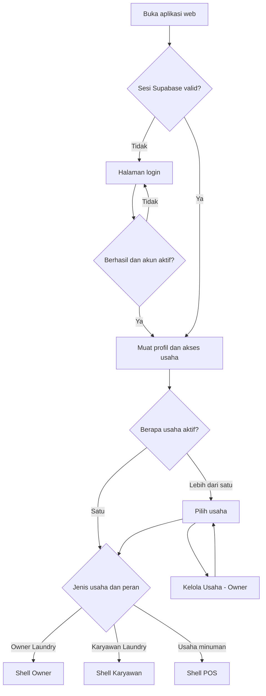

Aturan:

- akun nonaktif ditolak saat login;
- usaha nonaktif tidak bisa dipilih untuk transaksi baru;
- owner mengakses usaha milik tokonya, karyawan hanya usaha dengan membership aktif;
- jika hanya ada satu usaha aktif, langkah pilih usaha dilewati;
- pindah usaha dilakukan sadar lewat menu, dan nama usaha aktif selalu terlihat di header;
- route yang salah peran diarahkan ke Beranda dengan pesan akses ditolak. Ini hanya kenyamanan UI, otorisasi sebenarnya tetap RLS.

## 2. Membuat pesanan laundry (ORD-01, ORD-02)

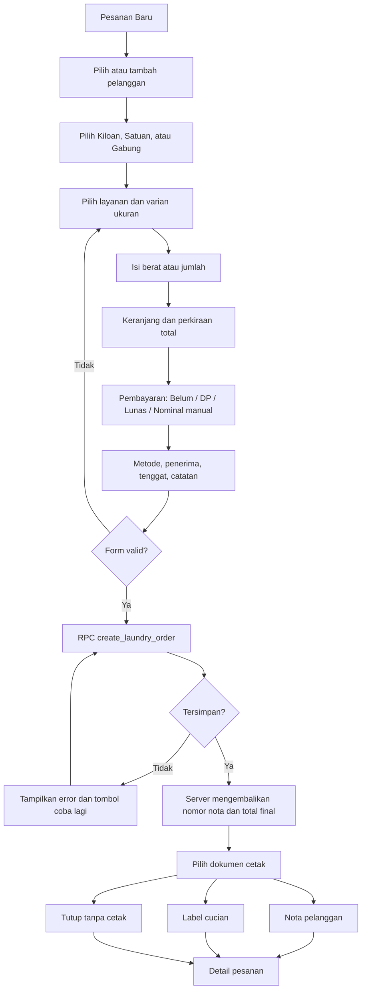

Catatan:

- total di keranjang hanya **perkiraan**. Total final, nomor nota, dan pembulatan ke atas kelipatan Rp1.000 berasal dari server;
- tombol Simpan dinonaktifkan saat proses berjalan untuk mencegah pesanan ganda;
- jika koneksi putus saat simpan, aplikasi **tidak** menganggap berhasil. Kasir diminta memeriksa daftar pesanan sebelum mengulang;
- insentif item sepatu/helm/tas dipilih pada item satuan dan ikut tersimpan dalam satu transaksi (ORD-09).

## 3. Status pesanan, pembayaran, dan pengambilan (ORD-05 s.d. ORD-07, PAY-01 s.d. PAY-03)

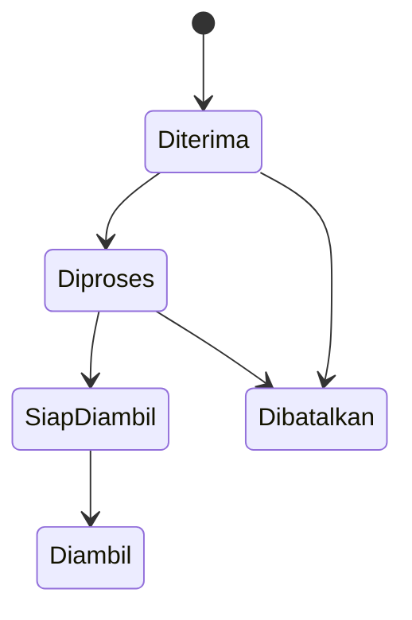

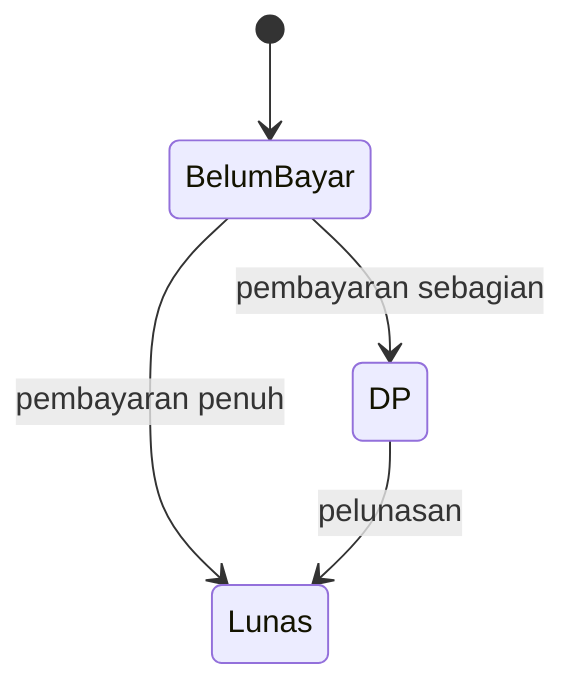

Status kerja dan status bayar **disimpan terpisah**. Pesanan boleh `Diambil` walau belum `Lunas`.

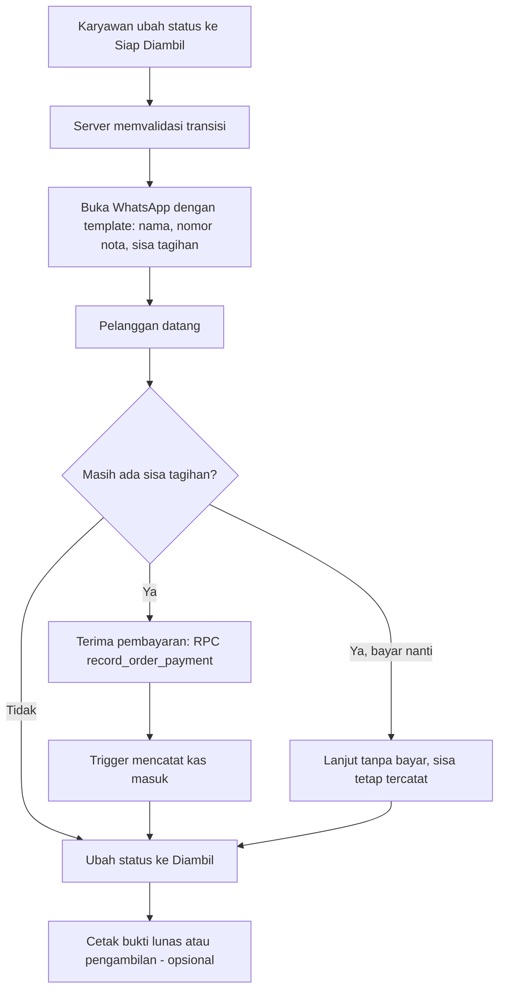

Koreksi pembayaran (nominal, metode, tanggal) hanya oleh owner lewat RPC. Server memperbarui pembayaran, status bayar, baris kas, dan audit dalam satu transaksi (PAY-04).

## 4. Pembayaran, kas, dan laporan (PAY-05 s.d. PAY-07)

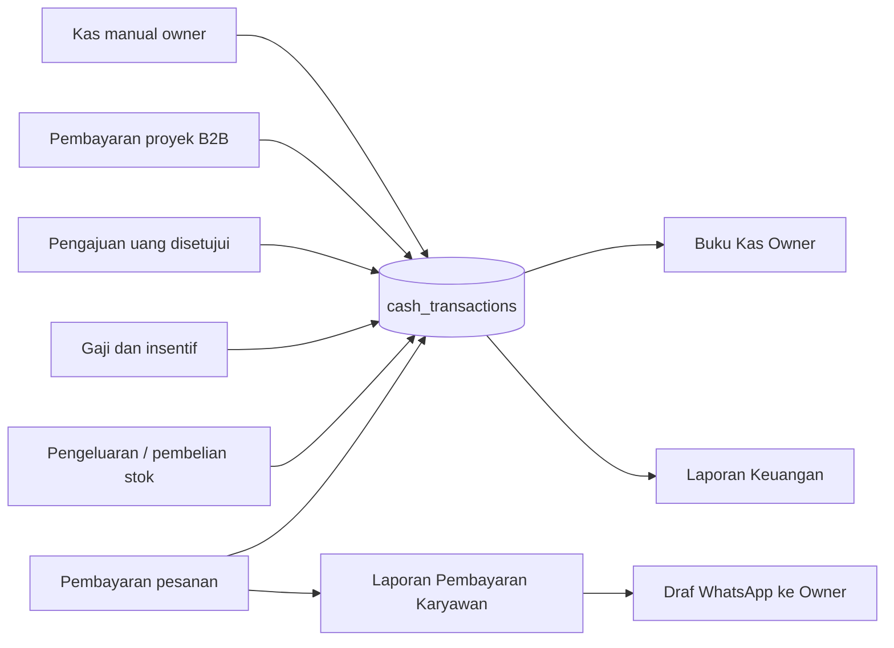

Aturan: web **tidak** menulis kas hasil pembayaran sendiri. Semua baris kas dibuat trigger database. Hybrid hanya penanda (nota yang dibayar tunai dan transfer) dan tidak dijumlahkan dua kali.

## 5. Pelanggan, kontak, dan poin (CUS-01 s.d. CUS-05)

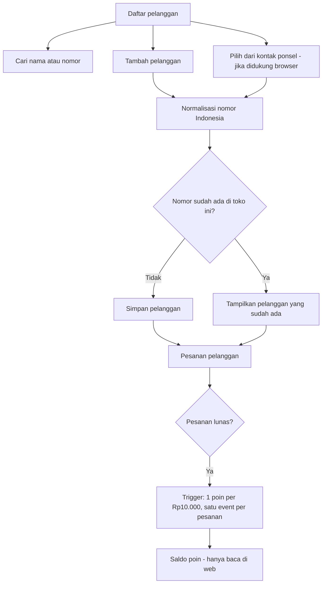

Berbeda dari Android: tidak ada sinkron kontak otomatis. Pilih kontak memakai Contact Picker (Chrome Android) dan selalu manual (lihat bagian 12).

## 6. Pengajuan karyawan (REQ-01 s.d. REQ-04)

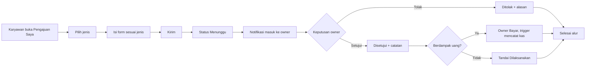

Jenis: Kebutuhan Stok, Lembur, Tukar Shift, Izin, Kasbon. Nilai `completed` di database untuk pengajuan non-uang ditampilkan sebagai **Dilaksanakan**, bukan "Selesai".

## 7. Stok dan pengeluaran (INV-01 s.d. INV-04, EXP-01)

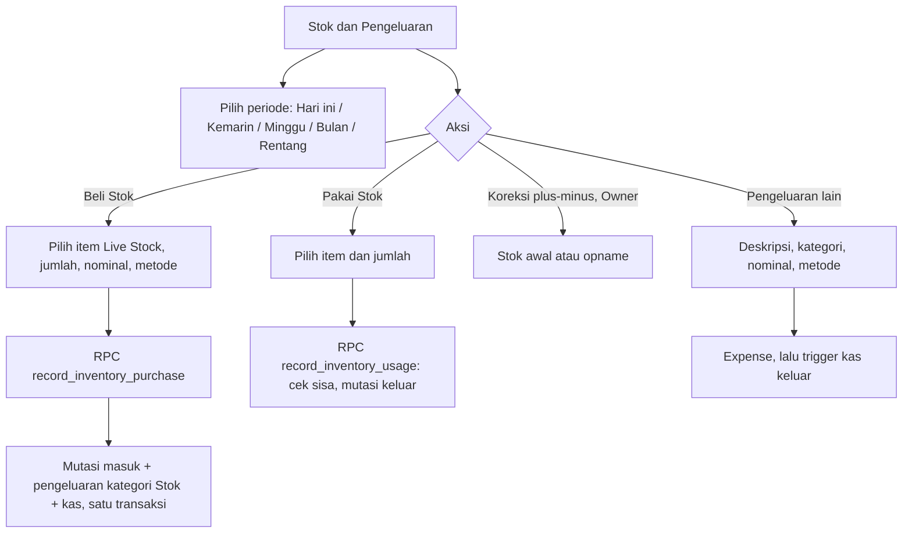

- Pakai Stok **tidak** membuat pengeluaran kas kedua.
- Jenis plastik berbeda adalah item Live Stock berbeda.
- Item stok menipis ditandai di Beranda owner.

## 8. Absensi, jadwal, dan gaji (ATT-01 s.d. ATT-03, SHF-01, PAYR-01, PAYR-02)

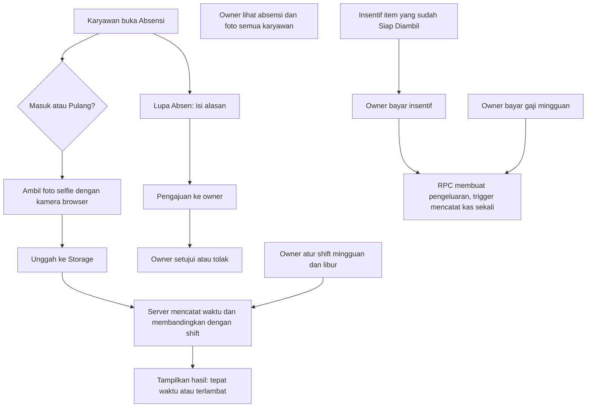

Waktu absen **selalu dari server**, bukan jam perangkat.

## 9. Proyek laundry besar B2B (PRJ-01 s.d. PRJ-03)

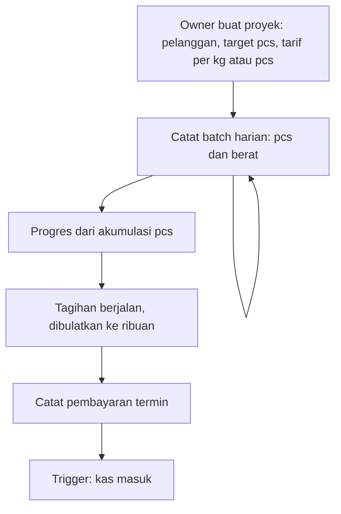

## 10. POS minuman (POS-01 s.d. POS-05)

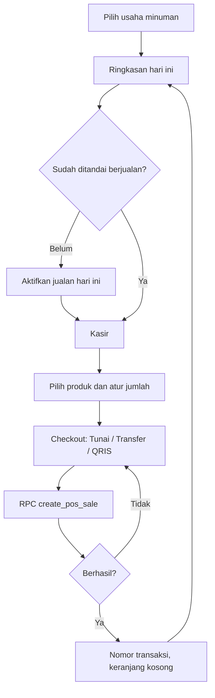

Jika butuh ukuran atau topping, owner membuatnya sebagai produk terpisah (varian baru ada di P2).

## 11. Notifikasi dan sinkronisasi (NTF-01 s.d. NTF-03, NFR-04)

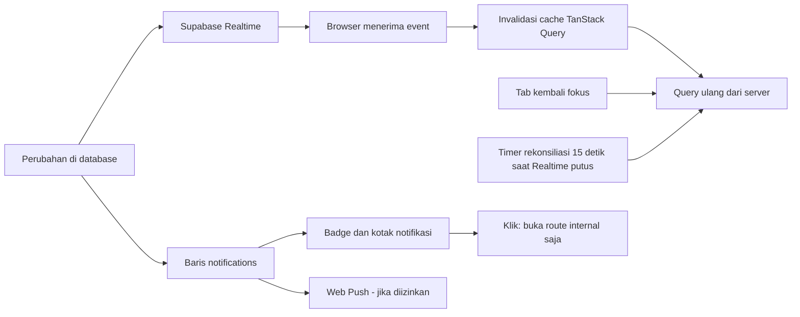

Event Realtime hanya **pemicu query ulang**. Angka dan status final selalu dari hasil query.

## 12. Perbedaan alur dibanding Android

| Area | Android | Web | Dampak pada alur |
| --- | --- | --- | --- |
| Cetak | Bluetooth langsung dari aplikasi | Bergantung hasil uji printer (PRD bagian 7): Web Bluetooth, RawBT, Web Serial, atau PDF | Setelah simpan pesanan, pilihan cetak tetap sama. Jika printer gagal, ada tombol PDF/WhatsApp dan transaksi tetap tersimpan. |
| Kontak | Sinkron otomatis dengan akun Google | Pilih kontak manual atau tambah pelanggan | Pelanggan baru diisi saat membuat pesanan |
| Absensi | Kamera aplikasi | Kamera browser (izin per situs) | Izin kamera diminta saat pertama kali |
| Update aplikasi | Unduh dan pasang APK | Banner "Versi baru tersedia, muat ulang" | Tidak ada alur instal |
| PIN cepat | PIN lokal | Sesi login panjang dan kunci layar opsional | Tidak ada layar PIN di v1 |
| Push | FCM | Web Push, dengan keterbatasan iPhone | Notifikasi in-app tetap jalur utama |
| Offline | Sebagian cache lokal | Data terakhir dapat dibaca, aksi keuangan butuh koneksi | Banner offline dan tombol tulis dinonaktifkan |

## 13. Peta halaman per peran

> Peta ini adalah **rancangan target**. Halaman yang sudah ada dan statusnya dicatat di [03-IMPLEMENTATION-PLAN.md](03-IMPLEMENTATION-PLAN.md). Saat ini hanya sisi Owner yang dibuat (belum ada pemisahan peran), dan route seperti `/orders/me`, `/attendance/me`, `/shifts/me`, dan `/pos/*` belum ada.

### Owner

| Route | Halaman | Kebutuhan |
| --- | --- | --- |
| `/sign-in` | Login | AUTH-01 |
| `/businesses` | Pilih usaha | AUTH-02 |
| `/businesses/manage` | Kelola usaha dan assignment karyawan | AUTH-04 |
| `/dashboard` | Beranda: KPI, pengajuan menunggu, pesanan terbaru | RPT-01 |
| `/orders` | Daftar pesanan | ORD-03 |
| `/orders/new` | Pesanan baru | ORD-01 |
| `/orders/:id` | Detail, status, pembayaran, cetak, koreksi | ORD-04, PAY-04 |
| `/customers` | Pelanggan dan detail poin | CUS-01, CUS-03 |
| `/services` | Layanan dan harga | SVC-01 |
| `/inventory` | Live Stock, beli, pakai, koreksi | INV-01 s.d. INV-04 |
| `/expenses` | Pengeluaran | EXP-01 |
| `/cashbook` | Buku Kas | PAY-05, PAY-07 |
| `/reports` | Laporan Pesanan dan Keuangan | RPT-02 |
| `/analytics` | Grafik | RPT-04 |
| `/requests/review` | Pusat Pengajuan | REQ-02 |
| `/employees` | Karyawan | EMP-01 |
| `/shifts` | Jadwal semua karyawan | SHF-01 |
| `/attendance` | Absensi semua karyawan | ATT-03 |
| `/payroll` | Gaji dan insentif | PAYR-01, PAYR-02 |
| `/projects` | Proyek B2B | PRJ-01 s.d. PRJ-03 |
| `/pos/*` | Ringkasan, kasir, produk POS | POS-01 s.d. POS-05 |
| `/audit` | Audit | AUD-01 |
| `/settings/shop`, `/printer` | Pengaturan toko dan printer | SET-01, PRN-03 |
| `/notifications`, `/profile` | Notifikasi dan profil | NTF-01, AUTH-05 |

### Karyawan Laundry

| Route | Halaman |
| --- | --- |
| `/dashboard` | Beranda dengan aksi cepat |
| `/orders/me`, `/orders/new`, `/orders/:id` | Pesanan Saya, baru, detail |
| `/customers` | Pelanggan |
| `/attendance/me`, `/shifts/me` | Absensi dan jadwal saya |
| `/requests/me`, `/requests/stock`, `/requests/overtime`, `/requests/shift-swap`, `/requests/leave`, `/requests/cash-advance` | Pengajuan |
| `/inventory` | Live Stock (pakai stok) |
| `/reports/payments` | Laporan Pembayaran |
| `/notifications`, `/profile`, `/printer` | Notifikasi, profil, printer |

### Anggota POS

| Route | Halaman |
| --- | --- |
| `/pos` | Ringkasan hari ini |
| `/pos/cashier` | Kasir |
| `/pos/products` | Produk (hanya lihat untuk non-owner) |
| `/pos/more` | Lainnya, profil, keluar |

Path mengikuti rute Android yang ada agar istilah tetap sama. Pengecualian: `/analytics` dan `/audit` baru di web.

Navigasi bawah (ponsel): Owner = Beranda, Pesanan, Pelanggan, Lainnya. Karyawan = Beranda, Pesanan Saya, Absensi, Lainnya. POS = Ringkasan, Kasir, Produk, Lainnya. Di desktop, owner memakai sidebar dengan grup Ringkasan, Operasional, Tim, Keuangan, Kontrol.

## 14. Aturan lintas alur

1. **Gagal tidak boleh terlihat sukses.** Setiap simpan menampilkan hasil. Nol baris berubah dianggap gagal.
2. **Tombol kembali** menuju halaman asal, termasuk dari notifikasi.
3. **Konfirmasi** untuk aksi yang tidak bisa dibatalkan: batalkan pesanan, hapus pelanggan, nonaktifkan karyawan, koreksi pembayaran.
4. **Satu aksi simpan aktif** pada satu waktu untuk mencegah data ganda.
5. **Sesi habis** mengembalikan ke login dan kembali ke halaman yang sama setelah masuk.
